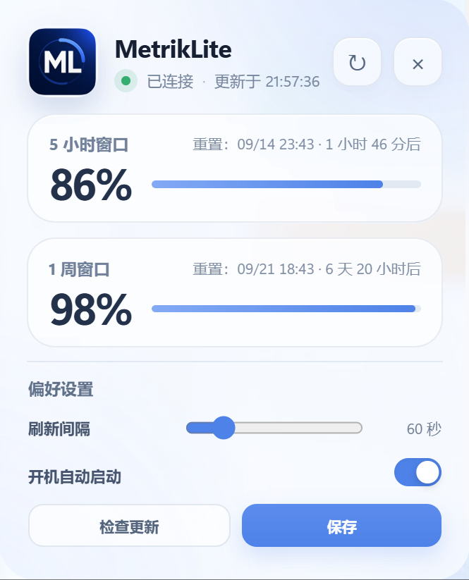
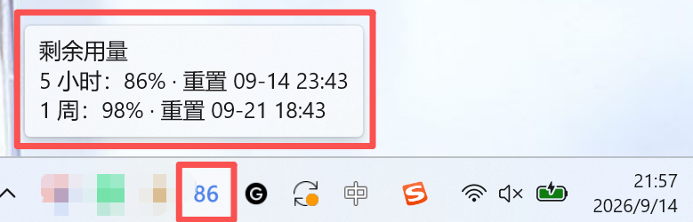

# MetrikLite

<p align="center">
  
</p>

<p align="center">
  <strong>See your Codex 5-hour and weekly quota directly in the Windows tray.</strong><br />
  Lightweight, native, and local-first. It does not read conversations or project files.
</p>

<p align="center">
  <a href="https://github.com/mors-lee/MetrikLite/releases/latest"></a>
  <a href="https://github.com/mors-lee/MetrikLite/actions/workflows/ci.yml"></a>
  <a href="https://github.com/mors-lee/MetrikLite/actions/workflows/codeql.yml"></a>
  
  <a href="./LICENSE"></a>
</p>

<p align="center">
  <a href="./README.md">中文</a> ·
  <a href="https://github.com/mors-lee/MetrikLite/releases/latest">Latest release</a> ·
  <a href="https://github.com/mors-lee/MetrikLite/issues">Issues</a> ·
  <a href="./SECURITY.md">Security</a>
</p>

## Screenshots

<p align="center">
  
  <br><strong>Main panel: both quota windows and embedded preferences</strong><br>
  The current version keeps quota details, refresh interval, autostart, update checks, and save actions on one page.
</p>

<p align="center">
  
  <br><strong>Windows tray number</strong><br>
  The tray number shows the 5-hour remaining percentage; hovering reveals both quota windows and reset times.
</p>

## At a glance

MetrikLite renders the Codex **5-hour remaining percentage** as a numeric Windows notification-area icon. Hover over the number to see both quota windows and reset times, or left-click for a panel above the taskbar.

- Auto-scaled, optically centered values from `0` to `100`.
- Hover text lists the 5-hour and weekly remaining percentages with reset times.
- One-page panel showing both the 5-hour and weekly quota windows plus embedded preferences, anchored to the active monitor work area.
- Multi-monitor and high-DPI aware positioning with complete rounded corners.
- One persistent local Codex app-server session reused across refreshes.
- Current-user autostart, manual refresh, automatic CLI discovery, and update checks.
- Rust + Tauri 2; the official NSIS installer is approximately 1.3 MB.

> The tray number uses the 5-hour window, while the main panel and hover text show both the 5-hour and weekly windows.

## Download

[Download the MetrikLite v2.0.6 installer](https://github.com/mors-lee/MetrikLite/releases/download/v2.0.6/MetrikLite_2.0.6_x64-setup.exe)

The [latest Release](https://github.com/mors-lee/MetrikLite/releases/latest) contains:

| Asset | Purpose |
| --- | --- |
| `MetrikLite_*_x64-setup.exe` | Recommended per-user NSIS installer |
| `MetrikLite_*_x64_en-US.msi` | MSI deployment package |
| `MetrikLite-portable.exe` | Portable executable |
| `SHA256SUMS.txt` | SHA256 checksums for Release assets |
| `MetrikLite-SBOM.spdx.json` | SPDX JSON software bill of materials |

Windows 10/11 x64 is supported. If Microsoft Edge WebView2 Runtime is missing, the installer uses Microsoft's official bootstrapper.

## First run

1. Install and launch MetrikLite.
2. If an independent Codex CLI is installed and signed in, the tray shows the 5-hour remaining percentage.
3. Hover over the number for both windows; left-click for the dual-window panel; right-click for refresh, updates, downloads, and exit.
4. Adjust the refresh interval or autostart in the main panel and click **Save** when needed.

If Codex is unavailable, MetrikLite stays accessible with a `!` tray icon and an actionable main panel instead of silently disappearing.

## SmartScreen and verification

Public builds are not currently signed with a commercial Authenticode certificate, so Windows may show **Unknown publisher**. This does not mean malware was detected, but it should not be ignored:

1. Download only from `github.com/mors-lee/MetrikLite/releases`.
2. Verify the file against `SHA256SUMS.txt`.
3. Consider Windows Defender, VirusTotal, source review, and GitHub Actions history together.

No single signal—including a code signature or a VirusTotal `0/70` result—proves absolute safety.

## Tray behavior

| Display | Meaning |
| --- | --- |
| `0`–`100` | Codex 5-hour remaining percentage |
| Red value | No more than 20% remains |
| `!` | Codex quota is temporarily unavailable |

Hover text shows the 5-hour and weekly remaining percentages with their reset times.

The default refresh interval is 30 seconds and can be configured from 10 to 300 seconds. Local files are stored under:

```text
%APPDATA%\MetrikLite\config.json
%APPDATA%\MetrikLite\metriklite.log
%LOCALAPPDATA%\MetrikLite\Runtime
```

## Codex discovery

MetrikLite checks `CODEX_BINARY`, official `OpenAI.Codex_*` WinGet packages, `%APPDATA%\npm\codex.cmd`, and then `PATH`. Protected WindowsApps paths and known unrelated launchers are skipped.

## Privacy and network access

MetrikLite reads only its own local configuration, an automatically discovered Codex CLI path, quota data returned by Codex app-server, and Segoe UI font data used to render the tray number.

It does **not** read Codex conversations, prompts, responses, project files, repositories, clipboard data, browser data, GitHub credentials, or Codex credential-file contents. MetrikLite never reads sensitive credentials, so no credential-access switch is required; Codex CLI owns authentication.

| Domain | When | Purpose |
| --- | --- | --- |
| `api.github.com` | Only after **Check for updates** | Public Release metadata |
| `github.com` | After the user opens downloads | Release page in the default browser |

OpenAI traffic used by Codex CLI to read account quota belongs to Codex itself and does not pass through a MetrikLite server. MetrikLite has no cloud service, analytics service, or advertising SDK.

## Build from source

Requirements: Windows 10/11 x64, Rust stable MSVC, Visual Studio 2022 C++ Build Tools, Node.js 22+, and WebView2 Runtime.

```powershell
npm ci
npm run tauri build
```

Quality checks:

```powershell
npm audit --audit-level=high
node --check src\main.js
cargo fmt --manifest-path src-tauri\Cargo.toml --all -- --check
cargo test --manifest-path src-tauri\Cargo.toml --locked
cargo clippy --manifest-path src-tauri\Cargo.toml --locked --all-targets -- -D warnings
```

## Release security

Every official Release is built from a public `v*` tag by GitHub Actions. Current Windows packages are not Authenticode-signed, so Windows may show **Unknown publisher**. The workflow publishes NSIS and MSI installers, a portable executable, SHA256 checksums, and an SPDX SBOM. Dependabot, CodeQL, `cargo audit`, and `npm audit` are enabled. See [SECURITY.md](SECURITY.md).

## License and attribution

MetrikLite is distributed under the [MIT License](LICENSE). The Rust/Tauri v2 implementation was written independently.

The quota-tray concept was inspired by [Metrik](https://github.com/keros68/metrik). MetrikLite is not an official OpenAI product.
