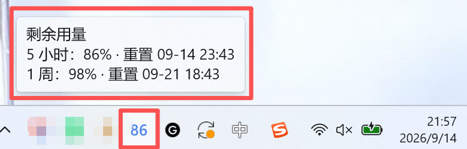
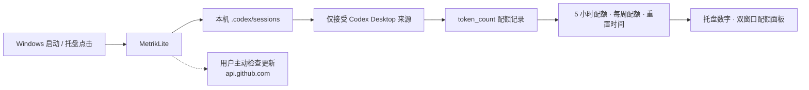

# MetrikLite

<div align="center">
  

  <h1>MetrikLite</h1>

  <strong>把 Codex 5 小时与每周配额放进 Windows 托盘。</strong><br>
  轻量、原生、本地优先：不用打开 Codex，也能随时看到剩余百分比与重置时间。

  <p>
    <a href="https://github.com/mors-lee/MetrikLite/releases/latest"></a>
    <a href="https://github.com/mors-lee/MetrikLite/actions/workflows/ci.yml"></a>
    <a href="https://github.com/mors-lee/MetrikLite/actions/workflows/codeql.yml"></a>
    
    
    <a href="./LICENSE"></a>
  </p>

  <p>
    <a href="./README.en.md">English</a> ·
    <a href="https://github.com/mors-lee/MetrikLite/releases/latest">下载最新版</a> ·
    <a href="https://github.com/mors-lee/MetrikLite/issues">问题反馈</a> ·
    <a href="./SECURITY.md">安全策略</a>
  </p>

  <br>
  
  
</div>

## 快速开始：下载并安装

### 推荐：NSIS 安装向导

> **[立即下载 MetrikLite v2.0.11](https://github.com/mors-lee/MetrikLite/releases/download/v2.0.11/MetrikLite_2.0.11_x64-setup.exe)**

也可以前往 [Latest Release](https://github.com/mors-lee/MetrikLite/releases/latest) 获取当前最新版：

| 文件 | 用途 |
| --- | --- |
| `MetrikLite_*_x64-setup.exe` | 推荐，当前用户 NSIS 安装向导 |
| `MetrikLite_*_x64_en-US.msi` | MSI 部署或企业软件分发 |
| `MetrikLite-portable.exe` | 免安装便携版 |
| `SHA256SUMS.txt` | Release 附件的 SHA-256 校验值 |
| `MetrikLite-SBOM.spdx.json` | SPDX JSON 软件物料清单 |

系统要求：Windows 10/11 x64。若系统没有 Microsoft Edge WebView2 Runtime，安装器会使用微软官方引导程序安装；Windows 11 和多数 Windows 10 设备已经预装。

### 安装与首次使用

1. 下载上方的 `MetrikLite_*_x64-setup.exe` 并运行安装向导。
2. 在 Codex 桌面端使用一次，再启动 MetrikLite 读取桌面端配额缓存。
3. 查看 Windows 托盘数字（显示 5 小时窗口剩余百分比）；左键点击数字打开同时显示 5 小时和 1 周窗口的配额面板，右键点击打开功能菜单。
4. 在主面板中调整刷新间隔或开机自启后点击“保存”；也可以点击顶部刷新按钮立即更新配额。

### 关于 Windows 的“未知发布者”提示

当前公开版本尚未配置 Authenticode 商业代码签名证书，因此 SmartScreen 可能提示“未知发布者”。这不等同于检测到病毒，但也不应被忽略：

1. 只从 [MetrikLite 官方 Releases](https://github.com/mors-lee/MetrikLite/releases) 下载。
2. 使用同一 Release 中的 `SHA256SUMS.txt` 核对下载文件。
3. 结合 Windows Defender、VirusTotal、源代码审查和 GitHub Actions 构建记录进行判断。

代码签名、VirusTotal 结果或任何单一信号，都不能单独证明软件绝对安全。

## 界面预览

<p align="center">
  <strong>主面板：双窗口配额与内嵌偏好设置</strong><br>
  支持浅色和苹果风格深色外观；5 小时、1 周配额、重置时间、刷新间隔和开机自启均在同一页。
</p>

<p align="center">
  
  <br><strong>Windows 托盘数字</strong><br>
  托盘数字显示 5 小时窗口剩余百分比；悬停可查看 5 小时与 1 周用量及重置时间。
</p>

## MetrikLite 是什么？

查看 Codex 配额通常意味着打开另一个窗口、找到对应页面，再确认下一次重置时间。MetrikLite 常驻 Windows 通知区域，把最需要的一项信息直接变成托盘数字：**当前 5 小时窗口还剩多少百分比**。

| 日常问题 | MetrikLite 的处理方式 |
| --- | --- |
| 想看配额，却要先打开 Codex | 托盘数字持续显示 5 小时剩余百分比，鼠标悬停即可查看 5 小时和 1 周用量 |
| 需要同时掌握短时和每周窗口 | 托盘显示 5 小时窗口，主面板和悬停提示同时显示两个窗口 |
| 托盘数字太小、不同位数难辨认 | `0`–`100` 自动缩放并居中，剩余不高于 20% 时显示红色 |
| 不想单独配置 CLI | 只读取桌面端生成的配额缓存，不启动独立 CLI |
| 面板经常挡住任务栏或跑到错误的屏幕 | 面板按当前鼠标所在显示器的工作区定位，支持多显示器和高 DPI |
| 不想把账号数据交给第三方服务 | 只读本机桌面端缓存；MetrikLite 没有自己的账户、云服务、分析或广告 SDK |

## 桌面端配额缓存，托盘显示



配额随桌面端写入记录而更新，并非独立实时请求。面板的更新时间使用记录本身的时间，不使用轮询时间；已过重置时间的窗口不沿用旧百分比。没有有效桌面端记录时显示 `!`，不会回退到 CLI。

## 核心能力

### 托盘数字，一眼知道 5 小时窗口还剩多少

- 显示 Codex 5 小时窗口的 `0`–`100` 剩余百分比。
- 单位数、两位数和三位数会自动缩放，保持在 32×32 托盘画布中清晰居中。
- 剩余百分比不高于 20% 时使用红色提醒。
- 暂时无法读取配额时显示 `!`，悬停提示会说明当前状态。
- 鼠标悬停同时显示 5 小时和 1 周剩余百分比及各自的重置时间。

### 双窗口面板，同时查看 5 小时与 1 周

- 左键点击托盘数字，显示或隐藏配额面板。
- 面板同时展示 5 小时和 1 周窗口的剩余百分比、进度条、绝对重置时间和相对倒计时。
- 右键菜单提供显示配额、立即刷新、检查更新、打开下载页面和退出。
- 面板锚定当前显示器工作区右下角，尽量避开任务栏；空间不足时回退到工作区左上角。
- 支持常规 Windows 缩放、多显示器和高 DPI 环境。

### 只读 Codex 桌面端配额

- 只接受会话元数据中来源为 `Codex Desktop`、且不是 `cli` 的记录。
- 从 `token_count` 事件中提取配额百分比、窗口时长、重置时间和记录时间。
- 不启动 Codex CLI，不读取 API Key、`auth.json` 或系统凭据库。
- 缓存更新依赖桌面端活动；请先在桌面端使用一次，再刷新面板。

### 桌面端缓存目录

默认读取当前用户目录下的 `.codex/sessions`。只解析来源元数据和配额事件，跳过 CLI 来源；不使用 `CODEX_BINARY`、WinGet、npm、`PATH` 或 CLI 的 `CODEX_HOME` 覆盖。


### 轻量配置，保持在本机

- 默认每 30 秒刷新一次，可调整为 10–300 秒。
- 可选当前用户开机自启，不需要管理员权限。
- 支持浅色与苹果风格深色主题，主题选择保存在本机。
- 配置和日志位于本机用户目录。

## 刷新、配置与本地文件

默认刷新间隔为 30 秒，设置范围为 10–300 秒。配置和日志位于：

```text
%APPDATA%\MetrikLite\config.json
%APPDATA%\MetrikLite\metriklite.log
```

开机自启只写入当前用户注册表：

```text
HKCU\Software\Microsoft\Windows\CurrentVersion\Run\MetrikLite
```

关闭面板不会退出程序；托盘菜单中的“退出”关闭 MetrikLite，不影响 Codex 桌面端。

## 隐私与联网范围

### MetrikLite 会读取

- MetrikLite 自己的本地配置和日志目录。
- 桌面端会话日志的来源元数据与配额事件；读取文件开头及有界尾部，不解析对话正文。
- 桌面端记录的 5 小时和 1 周配额百分比、窗口时长、重置时间和记录时间。
- Windows 字体目录中的 Segoe UI Semibold/Bold，仅用于渲染托盘数字。

### MetrikLite 不会读取

- 不解析、显示或上传 Codex 对话、提示词、回答正文。
- 项目源码、Git 仓库内容、文档或剪贴板。
- GitHub 密码、验证码、Token 或 Codex 凭据文件内容。
- 浏览器 Cookie、历史记录或保存的密码。

配额来自桌面端本地缓存，MetrikLite 不发起 OpenAI 认证或配额请求，不访问 CLI 凭据。MetrikLite 没有自己的云服务、用户账户、分析服务或广告 SDK。

### MetrikLite 自身请求的域名

| 域名 | 何时请求 | 用途 |
| --- | --- | --- |
| `api.github.com` | 用户点击“检查更新” | 获取公开 Release 的版本信息 |
| `github.com` | 用户主动打开下载页面 | 由默认浏览器显示 MetrikLite Release 页面 |

更新检查不是后台遥测；只有用户从托盘菜单或主面板中主动触发时才会请求 GitHub 公共 Release 元数据。

## 从源码构建

### 环境要求

- Windows 10/11 x64。
- Rust stable MSVC 工具链。
- Visual Studio 2022 Build Tools，包含 **Desktop development with C++**。
- Node.js 22+。
- WebView2 Runtime。

### 开发运行与生产构建

```powershell
npm ci
npm run tauri dev
npm run tauri build
```

### 本地检查

```powershell
npm audit --audit-level=high
node --check src\main.js
cargo fmt --manifest-path src-tauri\Cargo.toml --all -- --check
cargo test --manifest-path src-tauri\Cargo.toml --locked
cargo clippy --manifest-path src-tauri\Cargo.toml --locked --all-targets -- -D warnings
```

## 自动构建与供应链

正式 Release 由 GitHub Actions 从公开的 `v*` 标签自动构建：

1. 校验 Git 标签、`tauri.conf.json` 和 `Cargo.toml` 中的版本一致。
2. 构建 `metriklite.exe`、NSIS、MSI 和便携版 EXE。当前公开版本不配置 Authenticode 商业代码签名证书，Windows 可能显示“未知发布者”。
3. 生成 SPDX JSON SBOM 和 `SHA256SUMS.txt`。
4. 只有构建和校验步骤通过后，Draft Release 才会公开发布。

当前版本不需要配置代码签名证书或 `TAURI_SIGNING_PRIVATE_KEY`。如果未来启用 Authenticode，可参考 [`src-tauri/tauri.windows.conf.example.json`](src-tauri/tauri.windows.conf.example.json) 调整发布流程。

仓库同时启用了 Dependabot、CodeQL、`cargo audit` 和 `npm audit`。漏洞报告方式见 [SECURITY.md](SECURITY.md)。

## 项目结构

```text
src/                         无框架 HTML/CSS/JavaScript 面板
src-tauri/src/main.rs        Tauri 生命周期、托盘菜单与前端命令
src-tauri/src/codex.rs       桌面端来源过滤与本地配额缓存读取
src-tauri/src/models.rs      配额状态与 5 小时托盘选择逻辑
src-tauri/src/tray_icon.rs   数字渲染、缩放与面板定位
src-tauri/src/config.rs      配置持久化与当前用户开机自启
src-tauri/tauri.conf.json    窗口、权限及 NSIS/MSI 打包配置
docs/images/                 README 与项目文档使用的截图
.github/workflows/           CI、CodeQL 与 Release 工作流
```

## 许可证与声明

MetrikLite 使用 [MIT License](LICENSE)。托盘配额思路受到 [Metrik](https://github.com/keros68/metrik) 启发；MetrikLite 是独立实现，不是 OpenAI 官方产品，也不代表 OpenAI。

Copyright © 2026 Mors Lee.
